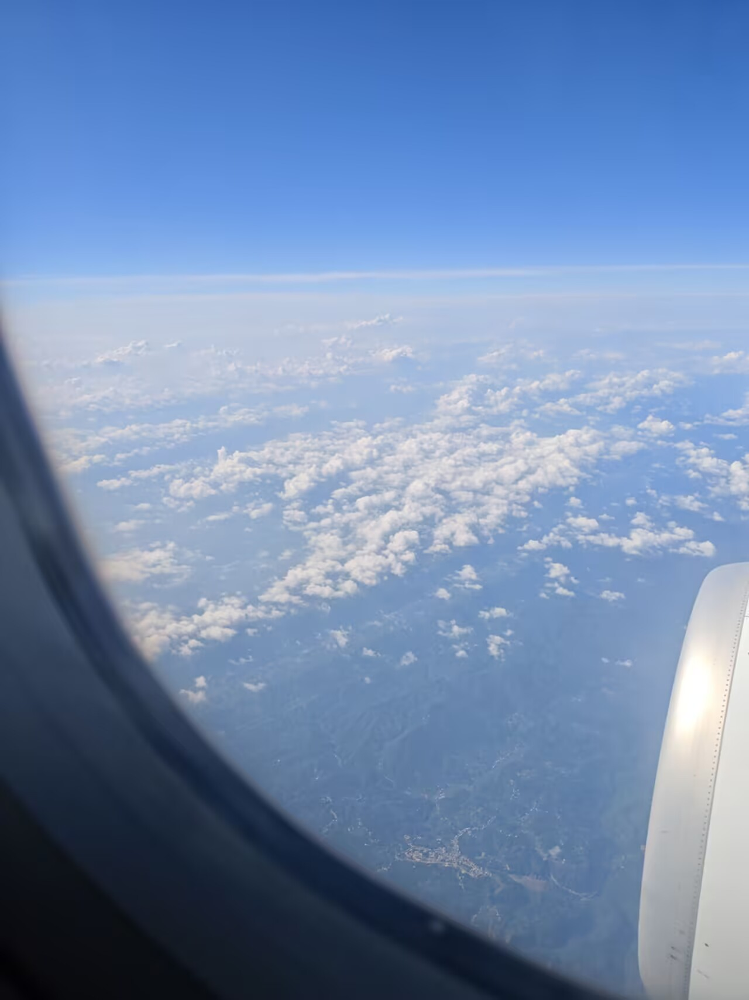
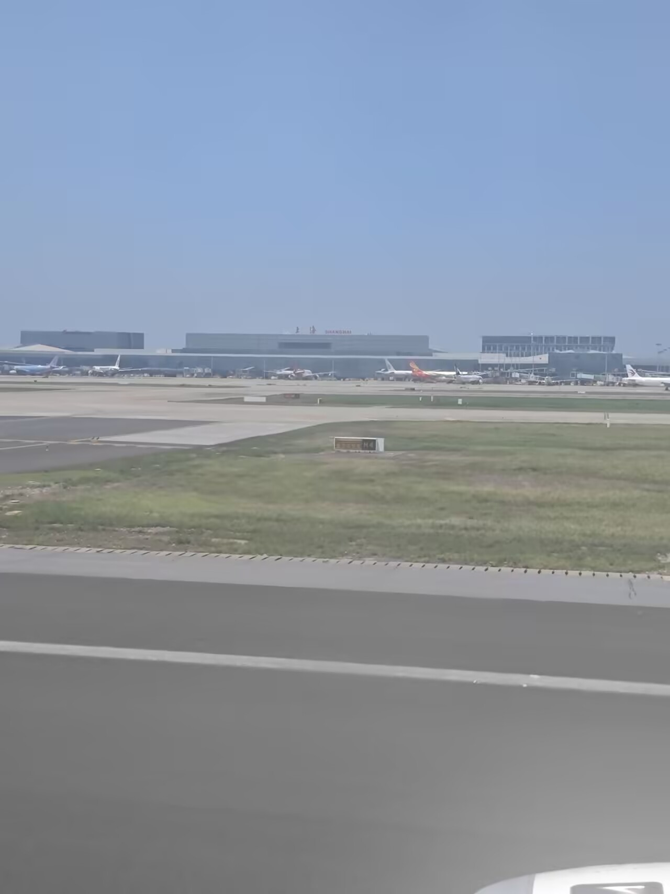
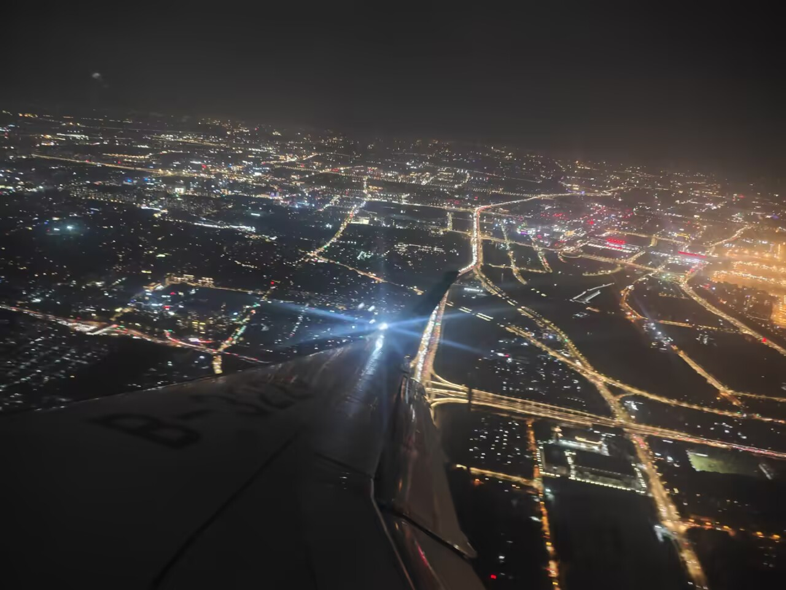
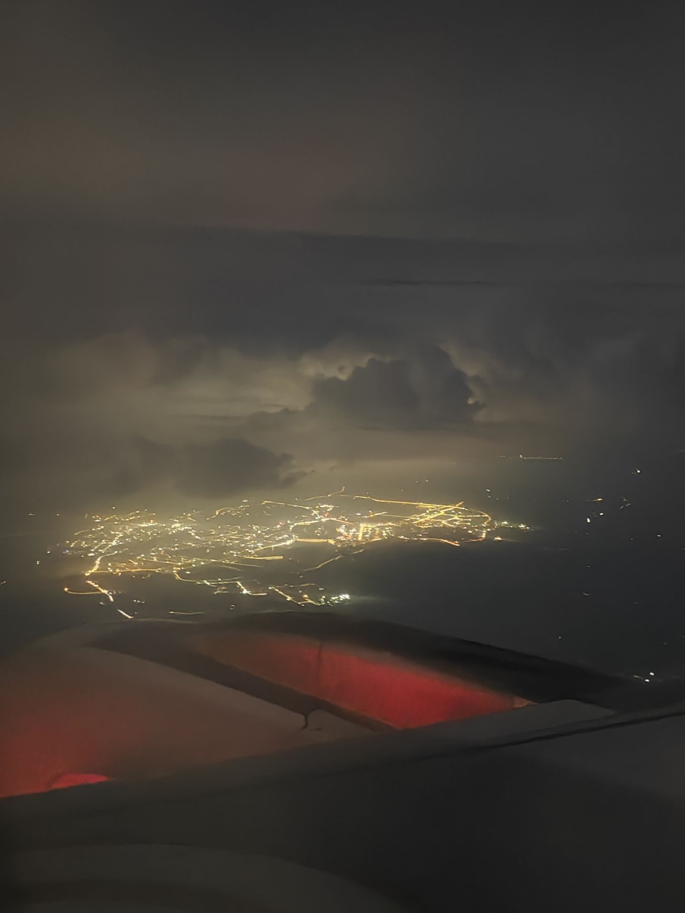

我突然想起自己似乎这件事还没怎么写。似乎是因为我当时有点失落感，那种强烈期待的事情落幕之后的不真实感。我记得那时发现生活还是以前的生活，流水还是从前的流水，那时好恍惚。

怎么，我以为去一次only展会给生活带来什么持久而激动人心的改变吗？

而且写到这里，我恍然意识到参展只是参展，而且我甚至只是买本，没有集章也没有参加活动。说真的人到底是生活在现生里的生物。我那时的怅然若失，大抵可以说是“莫说相公痴”那一类。呵呵。

不过，我之所以时隔三月又恍然想起，是因为C君说起她要去拿胶卷相机。香芋老师的相机周边我没有买真是追悔莫及。以及她这周打算去上海。我和她说去外滩吧。她说肯定要去外滩。是啊，肯定要去外滩。我当时坐了将近两个小时的地铁到达南京西路（？）。似乎从B口出去就是外滩，而且那个站人好多。但是我径直从C口出去去拍百联zx造趣场的大屏了。仰着头等了将近一个小时，真的是脖子痛背痛啊。然后将近九点就直接坐地铁走了。没去外滩。当时确实是觉得有什么好看的，现在也觉得似乎是有点遗憾了。

说到这里，想起那时肚子很饿，可是上海的东西，我吃到的那几顿，都是又贵又难吃啊。总之最后买了杯蜜雪冰城充饥，真狼狈啊。这么说来我把W君喊来还是有作用的，她点的外卖好吃。虽然我们一起出去吃的饭很一般。

刚下飞机那时好热，我撑了那几天唯一一次太阳伞。然后是下地铁，我在看站点的时候看到了同济大学，心里好疑惑。反应了一下才意识到自己到上海了，也才想起来同济在上海。其实也许没什么区别吧，毕竟我一直都是在地铁和商圈里。总之我就这么坐到了站，中途换乘那个站真是糟糕啊，明明是站内换乘结果居然有室外。当然也许这是我下午去大悦城那边的经历，我记不太清了。

出地铁口开始打车。同时出来的显然是同好，不过我看看她她看看我我们都没有开口。后来她凭借我书包上的小黑认出我了，那时她立刻开始还原场景，穿上黑外套解开头发，我完全记不起来，然后她背上那个有茂灵吧唧的痛包，啊我一下子就记起来了。其实当时是想要搭话的，听见她们的车没来我几乎想说和我一起吧，我打的车已经到了。但是我忍下来了。我不知道为什么，和人开口变得困难了。

而这是两三个小时之后的事，我到了酒店累死了只想睡觉，点了个外卖就睡了。不过几乎没睡好。然后就起来吃外卖，看《轻音少女》。B君说我倒安逸。本来想先洗头洗澡的，不过还是去给人送完无料就去快闪店了。本来说倒也不是一定要去，不过还是去了。不过大悦城里面竟然有卖衣服的，要是没有就更好了。食物当然是贵，没吃饱。在大悦城看见好多快闪店。对了我还盖了章。买了两个杯垫，就是看群里有人发杯垫的图太美了我才去的。

回去之后就是玩手机之类的无聊事吧。而且似乎还是熬到两点多，啧，糟糕啊。

啊啊中途去帮W君借到了卸妆水之类的，谢谢同好们。早上她来了，我继续睡。去吃饭，早饭超级难吃，很一般。然后就已经九点多了啊，虽然说v票十点入场但是已经排了十几个人了我真害怕，总感觉smp档案无望了。好后悔昨晚上熬夜，虽然确实有一种难以入睡的感觉在拖着我。是S型排队，所以我右边刚好是排在第一位的，差不多吧。她们在聊天，其中一个说起自己也是要来买本子，尤其是smp档案袋什么的，跟我一样啊。突然想起来那时提着自己做的无料，其实只是张明信片而已，但是超级紧张根本发不出去。提的袋子也是在快闪店买的，超大的，打算装本子。总之后面又来了一位cos的老师，她们两位就交谈起来。然后怎么的我就鼓起勇气把明信片给前前后后左左右右几个人发了。对虽然鼓起勇气也就是发了几张。现在想起来还会把手撑在额头上。我好没招啊。其实一直听到她们在聊《一人之下》，刚好聊到我也正看的那里，我是真的很好奇，很想搭话，很想发无料。然后在我给了无料之后，我实在忍不住，搭话了。问了一下陈朵的故事和结局，聊了诸葛青的cp，因为确实很荒谬嘛。

中间我说到“腐女”这个词，她有点惊讶，说你们现在也会这样说啊，我也很惊讶，也许是因为太多惊讶了没有处理好信息给出正确回答，我说我从初中就这么自称了。也许她搞错了我的年龄。前一天去换无料时候她们也搞错了我的年龄。我感觉我们是同龄人，而且她说话的感觉和我一位朋友很像。

还有一分钟就要入场了，我真的是着急起来了。觉得自己真的得不到smp档案袋了。然后我实在焦虑，竟然大胆起来，问她可不可以拿两份。这次这个刊本是不限量的。她说好。感激之情说不尽。果然等到我入场就没有了。谢谢同好。随的吧唧我给她了。刚好她很喜欢我也没什么太在意的。真好啊。

然后我就按着自己提前写好的次序依次去排队。不知道哪一本，听见摊主说是最后一本了。谢天谢地。不过太着急了把阿漓老师的新刊和电影集弄反了。然后不知道为什么也没有去排白指老师的画集，虽然当时觉得无所谓不过后来越来越难受了。嘛，其实也没多难受，说不上来的感觉。发现弄混了之后我懒得上去了就说哎呀那就不要了吧。然后通的时候还是入了。去五子兮老师那里场取的时候问我有一本没宣发的问我要不要，我没反应过来什么叫要不要。因为前一天换无料的时候也问我性转的要不要，我呆愣了一下说要的。不过本我没要。

然后我就下去了。一直收拾整理。下楼拿外卖的时候把钥匙扣给进来的cos老师了。当时觉得我有夏目的钥匙扣了留着不能发挥应有的作用不如给同好。就随手给出去了。因为我看她出cos应该是同好。外卖也没拿到。

等外卖终于上来的时候，我匆匆刨几口就去手书放映会了。找位置还挺难，不过还好找到了。但是坐下一会儿我意识到自己没带手环。可是也不可能立刻去拿吧，于是坐立难安地看完了手书。我甚至不敢鼓掌。这真是太难受了，我看着很想哭的，合绘的“奔向你”那里。arrow我之前似乎没有看过，当时在大屏上看到好惊艳的抬头。回想起来好幸福，但是我却记不清到底有哪些了，三千城阙老师的也许有两个，*sleepwalk*是有的，*反正*因为我自己看的次数太多了现在拿不准了，不过应该还是有的。阿漓老师的*cheers*大家一起看的感觉真好。还有参柏的很可爱的手书，啊啊为什么就记不太清了，真是的明明观影会都能记清楚的。

看完手书我又走了，不过现在有点后悔，应该看看现场的。但是当时我急着去吃饭，而且我一直不看真人。不过看视频似乎很有趣。

总之吃饭的记忆也很稀薄呢。然后就是观影会。我们一直在“喔～”啊啊啊啊啊啊现在想起来还是很激动兴奋啊啊啊啊啊啊啊啊啊啊啊啊家产，我们茂灵的镇圈神作是原作啊，啊啊啊啊啊啊啊啊啊啊啊！

诶多，“不想战斗的时候，逃跑也是可以的”，我真的完全被击败了啊你们！这世上唯有你们二人，因为不管成年人还是小孩，都是不可以逃跑的，是师匠替mob承担责任，所以mob才能松一口气好好成长，你做了他的退路，他才能逃跑啊。（诶不过什么都不用做就能力量转移有点可惜😔🙂）

师匠篇真是伤人啊，我自己看会跳过。嗯我有点不想承受。不过当时反正我们挺爽的，各种意义上。个人solo那一段，还真挺，就，总之就是我们在“哇”。不过重点到底是在最后上，这次逃跑的是师匠呢，虽然也不算逃跑啦这个人永远不会狼狈呢。说真的你在忍什么眼泪啊明明只是弟子诶好奇怪啊你。“好家伙”是什么嘛怎么连龙套都会开玩笑了这可是你师傅诶这么说可以的吗？好了好了家产你们快快在一起啊🫢。

然后就是那个铃木的老爹，他还真是有够狭隘的。其实律去拉将的时候也有些喔声。我觉得也挺好的。总之律在一看到灵幻被攻击立刻警惕起来哥哥要发生变化了那里，我们：哏哏嘿嘿😀😁。然后他双眼通红的起来的时候我们“喔～”得超大声。啊啊啊啊啊啊啊啊啊家产你们要怎样要怎样？他都不想说话了直接“算了偶尔也长点教训吧”。我真是无话可说。

差不多就进第三季了。这里印象没有特别深，因为开始看说的有剪辑，我还以为是补了一个拥抱，就在期待，结果没有，所谓剪辑应该是剪切。对这个印象太深了就没注意别的，而且虽然说这里很甜但是因为是去给别人告白我现在不细想的话还是不想想。不过我对蕾倒是很欣赏，说欣赏不太合适毕竟她那么优秀，但是这种既不是喜欢也不是推的感情也只好如此形容了，毕竟她年纪摆在那里我也不能说崇拜吧。倒退到她那个岁数可能可以，欸等等，现在24岁？！不对可能更大按原作设定，嗯，崇拜。

手书放完我下去买薯片，那之前或者之后我终于发出去些明信片。也许我鼓起勇气给的那位主持人是晒老师吧。

回去后我和W君打算看电影，我真是一如既往的固执呢，非要看《大话西游之大圣娶亲》，当时觉得这么好看一定要给她看看，结果她刷抖音去了，我换成《罗小黑战记2》，最后她还是刷抖音去了。也许我不该告诉她我已经看过了。这也是没办法的事。

第二天起来也不知道在做什么，坐地铁到了大悦城那边，吃了饭逛了逛，她走了。我继续看看，帮L君买了些巨人和alien stage的谷。走了。

到虹桥，喝了杯奶茶，吃了饭。进去托运行李。等来等去走来走去，买了八宝粥喝。上飞机。一切都顺理成章且自然，我却总觉得怪怪的。所有的本子都在行李箱里。好空虚啊。我看起《因为我曾见过星光》，没看多少飞机颠簸，有点凶。我想着我还有父母等着我养老送终，祈求上天。那时看见的不远处的城市，就是这里吧。

总之到了之后完全没睡着，于是时不时看手机，看完了*因为我曾见过星光*，它对我的触动是无法言说的。不管看几次。一切的一切，都是那么动人，是他们独一无二的属于彼此的爱意。两年前的这个时候，老师还发微博，老师也是茂灵only真是太好了，我只是这么觉得。

总之第二天一早就回来了。爆睡到下午两三点。那时7月27号。

而我是23号去的，去时还问了路。慢悠悠地拖着行李箱，揣着一颗怦怦跳的心脏，面带微笑。换乘再进航站楼。不知道怎么托运，办登机牌，咨询处的人问我机票是自己买的吗，似乎又是一个弄错我年龄的人。过安检的时候有些好笑，幸好没什么别的人。总之在里面走来走去，也许睡着了也许没有。然后早上坐飞机去上海了。

人不能同时拥有青春和对青春的感受。

**去上海**

**离开上海**